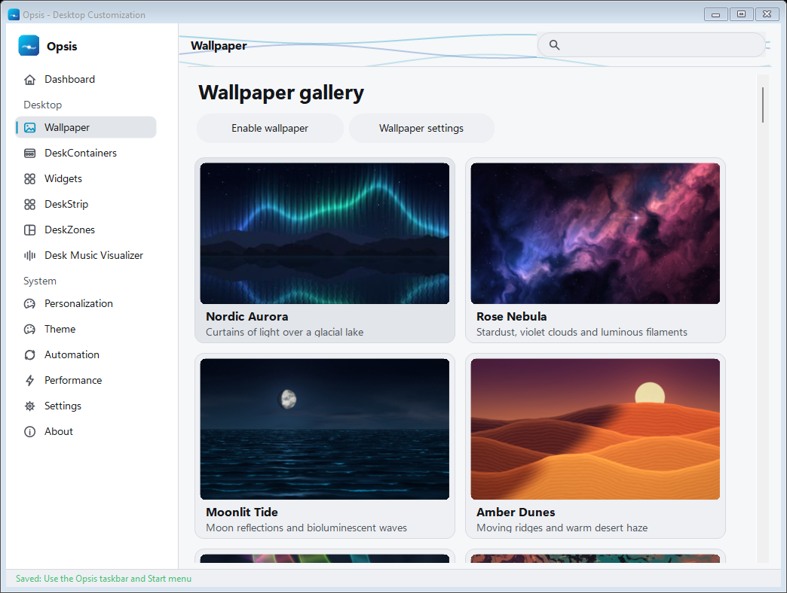
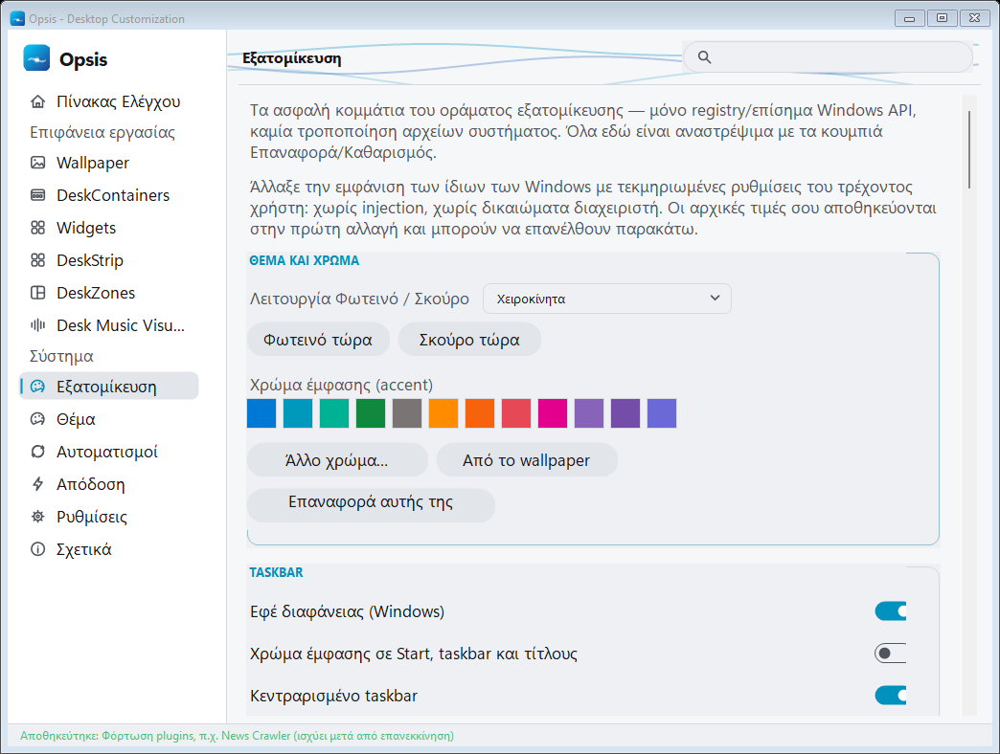

   

<a href="docs/GS-APP-LABS-FAQ.md">FAQ / Συχνές ερωτήσεις</a> · <a href="https://github.com/gs-applabs/Opsis/issues/new/choose">Feedback / Προτάσεις</a>

<strong>Make Windows feel like your own.</strong> Μεταμόρφωσε την επιφάνεια εργασίας σου με κινούμενα φόντα, widgets και εργαλεία εξατομίκευσης.

 

<a href="#at-a-glance--με-μια-ματιά">Overview / Επισκόπηση</a> · <a href="README-EL.md">Full documentation / Τεκμηρίωση</a> · <a href="https://github.com/gs-applabs/Opsis/issues">Support / Υποστήριξη</a> · <a href="https://github.com/gs-applabs">GS App Labs</a>

## Current screenshot gallery / Νέα στιγμιότυπα

<table>
<tr>
<td width="50%" valign="top"> Wallpaper gallery / Συλλογή φόντων</td>
<td width="50%" valign="top"> Windows personalization / Εξατομίκευση</td>
</tr>
</table>

**[Browse application screenshots / Προβολή στιγμιοτύπων](docs/product-snapshots/README.md)** · [Capture workflow / Μηχανισμός λήψης](../../actions/workflows/product-snapshots.yml)

Actual application rendering on Windows CI. / Πραγματική απεικόνιση σε Windows CI.

## At a glance / Με μια ματιά

| Workspace | What you can do / Τι μπορείς να κάνεις |
|---|---|
| Appearance / Εμφάνιση | Live and static wallpapers, weather scenes, themes and Windows personalization / Κινούμενα και στατικά φόντα, σκηνές καιρού και θέματα |
| Desktop / Επιφάνεια | Widgets, DeskContainers, DeskStrip, DeskZones and DeskFlip / Οργάνωση επιφάνειας εργασίας και εναλλαγή παραθύρων |
| Control / Έλεγχος | Profiles, automation and system monitoring / Προφίλ, αυτοματισμοί και παρακολούθηση |
| Sound / Ήχος | Desktop music visualization and integration with installed Media Suite / Οπτικοποίηση μουσικής και διασύνδεση Media Suite |
| Extensions / Πρόσθετα | Plugin contract 1.0.0.0; optional family integrations / Προαιρετικές επεκτάσεις της οικογένειας |

## Get started / Ξεκίνημα

1. Download [OpsisSetup.exe](https://github.com/gs-applabs/Opsis/releases/download/v2.8.0.2511/OpsisSetup.exe) and its [SHA-256 checksum](https://github.com/gs-applabs/Opsis/releases/download/v2.8.0.2511/OpsisSetup.exe.sha256).
2. Compare the checksum using `Get-FileHash .\OpsisSetup.exe -Algorithm SHA256`.
3. Install on Windows x64 with .NET 11 Desktop Runtime and WebView2 Runtime for web-rendered scenes. Close any running older version first.
4. Open OPSIS and choose your workspace. See the [Greek user and build guide](README-EL.md).

The installer is unsigned. Review operating-system warnings rather than bypassing them. / Ο εγκαταστάτης δεν έχει ψηφιακή υπογραφή· ελέγξτε την προέλευση και το SHA-256.

## Latest release / Τελευταία έκδοση

**2.8.0.2511** — refreshed start screen, version information and texts across 14 languages. See the [release notes](RELEASE-NOTES-2.8.0.2511.md) and [published release](https://github.com/gs-applabs/Opsis/releases/tag/v2.8.0.2511).

Clean interactive Windows 11 installation, mixed-DPI multi-monitor and full language visual checks are not confirmed in these release notes. / Δεν έχει ολοκληρωθεί κάθε διαδραστικός έλεγχος σε Windows 11 και πολλαπλές οθόνες.

## The OPSIS ecosystem / Οικοσύστημα

| Application | Role |
|---|---|
| [OPSIS Media Suite](https://github.com/gs-applabs/OpsisMediaSuite) | Audio and video / Πολυμέσα |
| [OPSIS News Crawler](https://github.com/gs-applabs/OpsisNewsCrawler) | News, markets and weather / Ενημέρωση |
| [Chronikologio](https://github.com/gs-applabs/san-shmera) | Calendar and historical events / Εορτολόγιο και ιστορία |

Standalone applications have separate installation requirements. Plugin compatibility is documented per release.

## Documentation / Τεκμηρίωση

- [Full Greek documentation](README-EL.md)
- [Release notes](RELEASE-NOTES-2.8.0.2511.md)
- [Source archive](https://github.com/gs-applabs/Opsis/releases/download/v2.8.0.2511/Opsis-2.8.0.2511-Source.zip)
- [License](LICENSE) and [third-party notices](THIRD_PARTY_NOTICES.md)
- [Report an issue](https://github.com/gs-applabs/Opsis/issues)

---

<a href="https://github.com/gs-applabs"><b>GS App Labs</b></a> · Independent software studio · Made in Greece

