

# Visual showcase / Οπτική παρουσίαση

[Product / Εφαρμογή](../README.md) · [Latest published release / Τελευταία δημοσιευμένη έκδοση](https://github.com/gs-applabs/Opsis/releases/latest) · [Original capture index](product-snapshots/README.md)

**13 screenshots / στιγμιότυπα** · Capture source: [`e1031e5c4646`](https://github.com/gs-applabs/Opsis/commit/e1031e5c46469b879045ce731f80bc87bd2fb514)

Actual application page captures from the UI audit on a disposable Windows VM; not a substitute for interactive testing.

These are development-source previews, not guaranteed to match the currently published installer or future builds. / Στιγμιότυπα συγκεκριμένου build ανάπτυξης, όχι εγγύηση ταύτισης με την τρέχουσα δημοσιευμένη έκδοση ή με μελλοντικά builds.

## Your desktop / Η επιφάνεια εργασίας

<table>
<tr>
<td width="50%" valign="top"><a href="product-snapshots/page-Dashboard.png">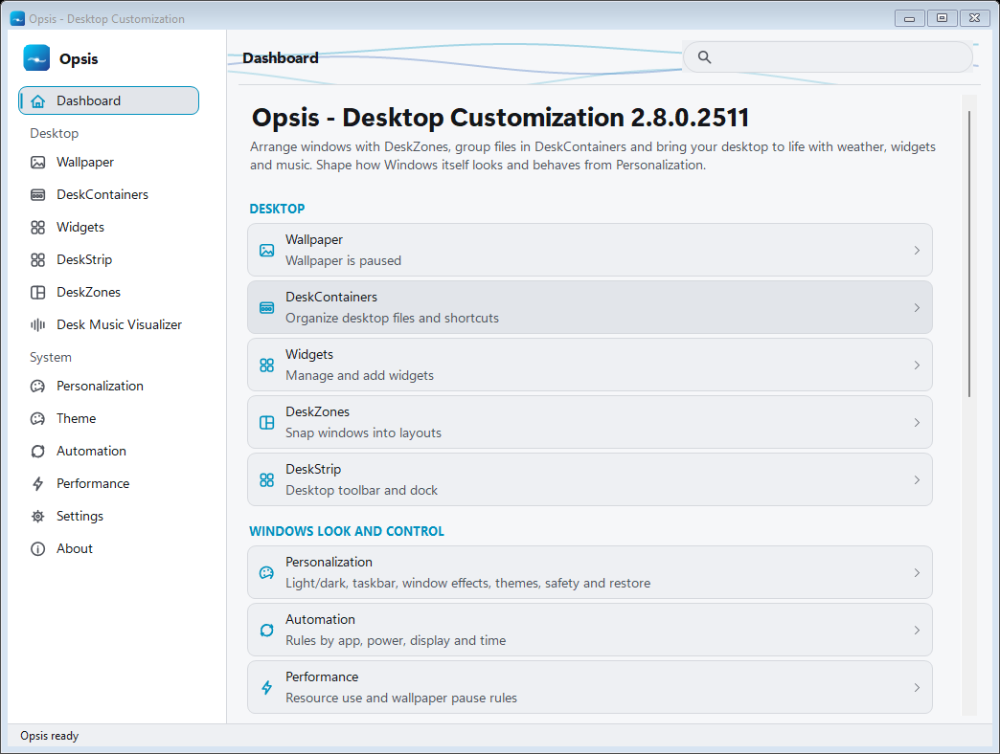</a> Dashboard</td>
<td width="50%" valign="top"><a href="product-snapshots/page-Personalization.png">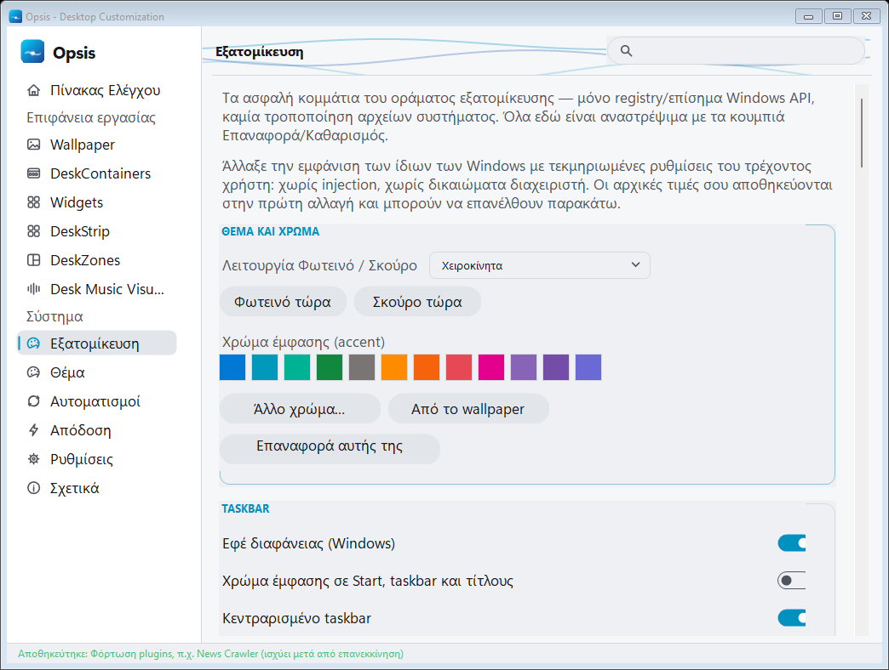</a> Personalization / Εξατομίκευση</td>
</tr>
<tr>
<td width="50%" valign="top"><a href="product-snapshots/page-Theme.png">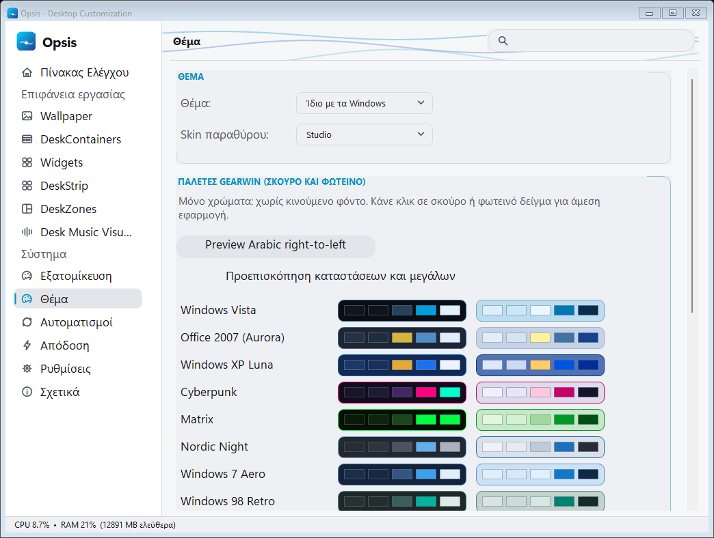</a> Theme</td>
<td width="50%" valign="top"><a href="product-snapshots/page-Wallpaper.png">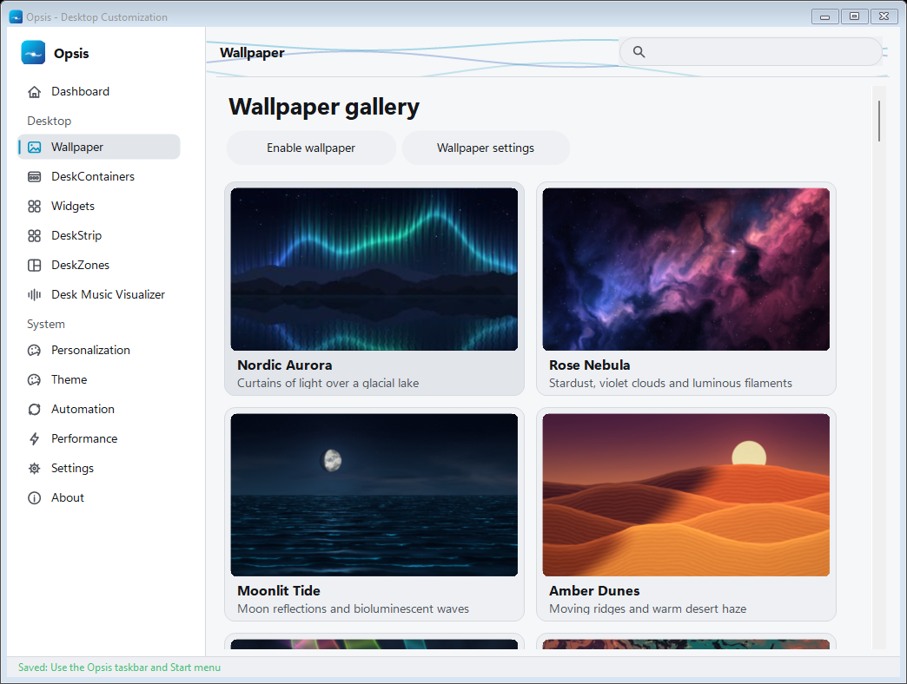</a> Wallpapers / Φόντα</td>
</tr>
<tr>
<td width="50%" valign="top"><a href="product-snapshots/page-Widgets.png">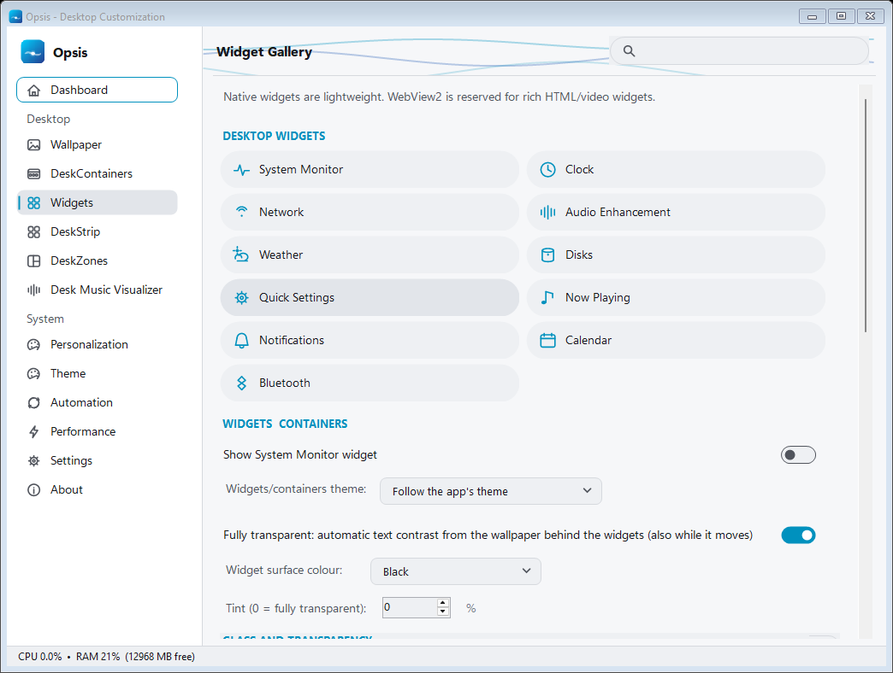</a> Widgets</td>
<td width="50%"></td>
</tr>
</table>

## Organize / Οργάνωση

<table>
<tr>
<td width="50%" valign="top"><a href="product-snapshots/page-DeskContainers.png">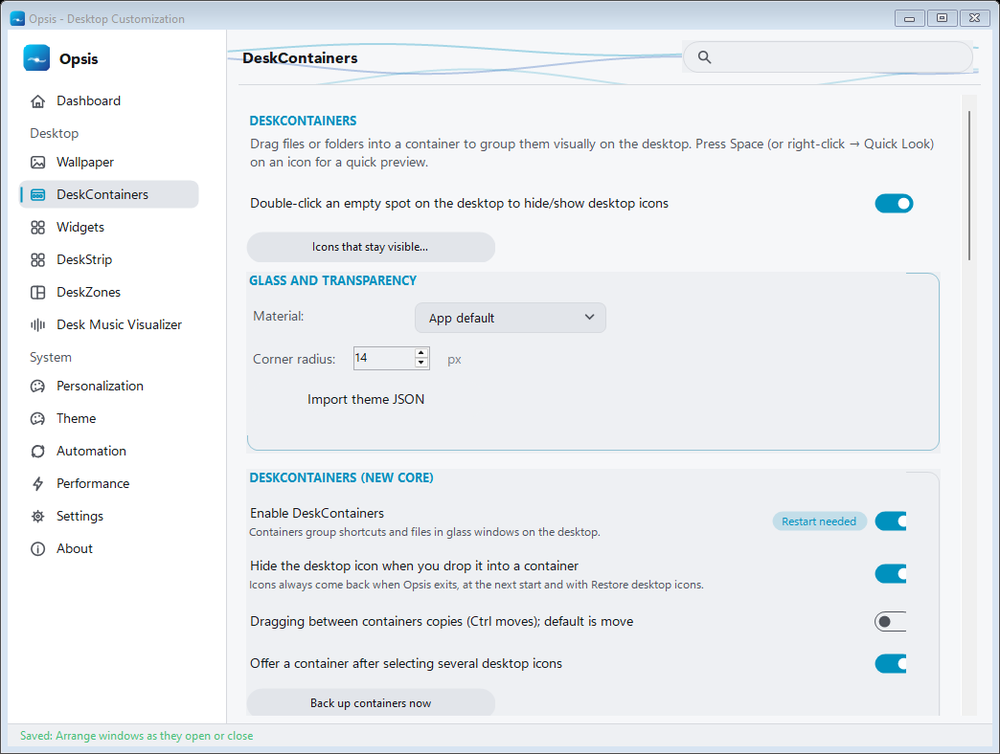</a> Desk Containers</td>
<td width="50%" valign="top"><a href="product-snapshots/page-DeskStrip.png">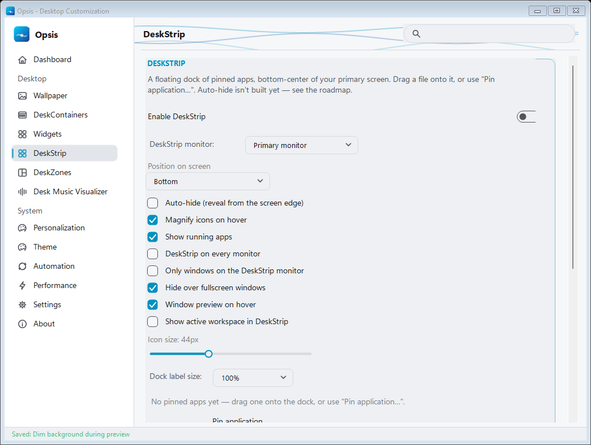</a> Desk Strip</td>
</tr>
<tr>
<td width="50%" valign="top"><a href="product-snapshots/page-DeskZones.png">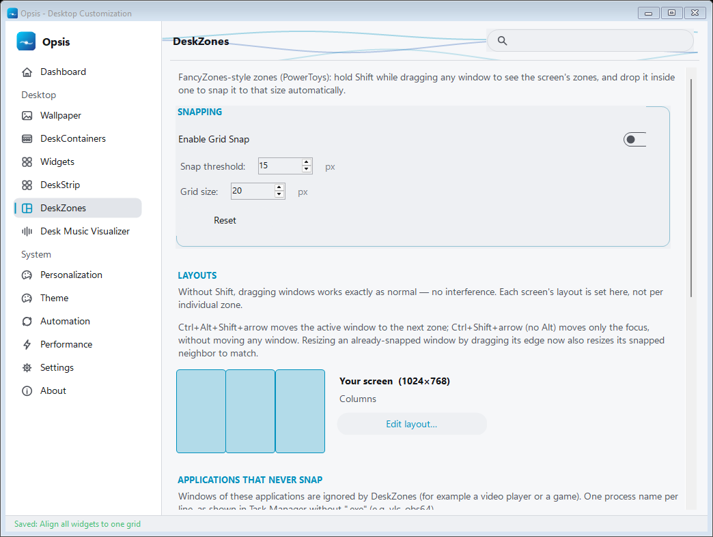</a> Desk Zones</td>
<td width="50%"></td>
</tr>
</table>

## Audio and control / Ήχος και έλεγχος

<table>
<tr>
<td width="50%" valign="top"><a href="product-snapshots/page-About.png">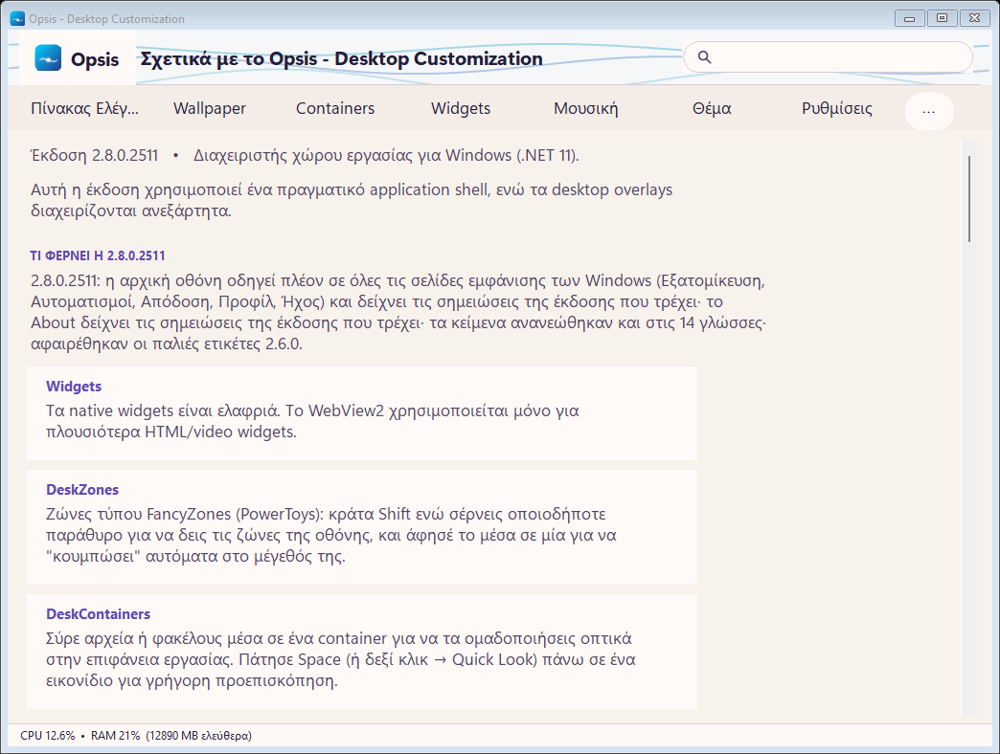</a> About</td>
<td width="50%" valign="top"><a href="product-snapshots/page-Automation.png">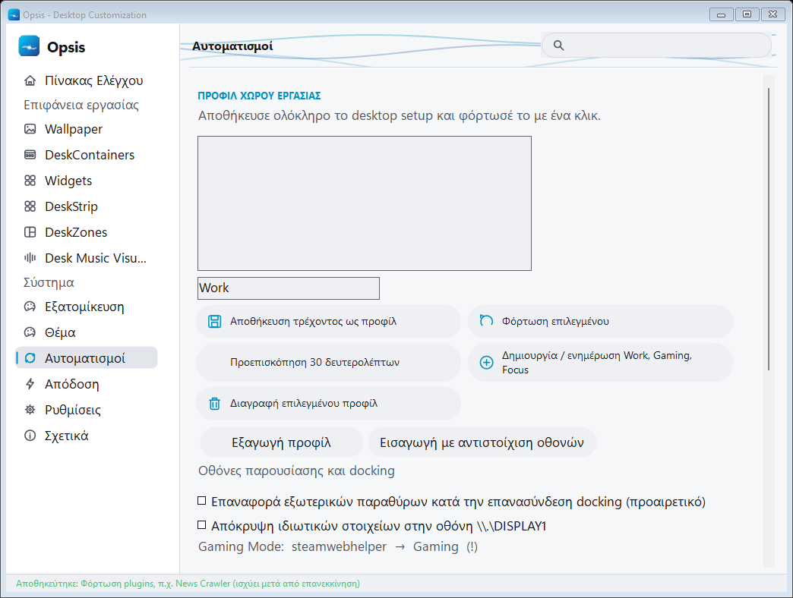</a> Automation</td>
</tr>
<tr>
<td width="50%" valign="top"><a href="product-snapshots/page-DeskMusicVisualizer.png">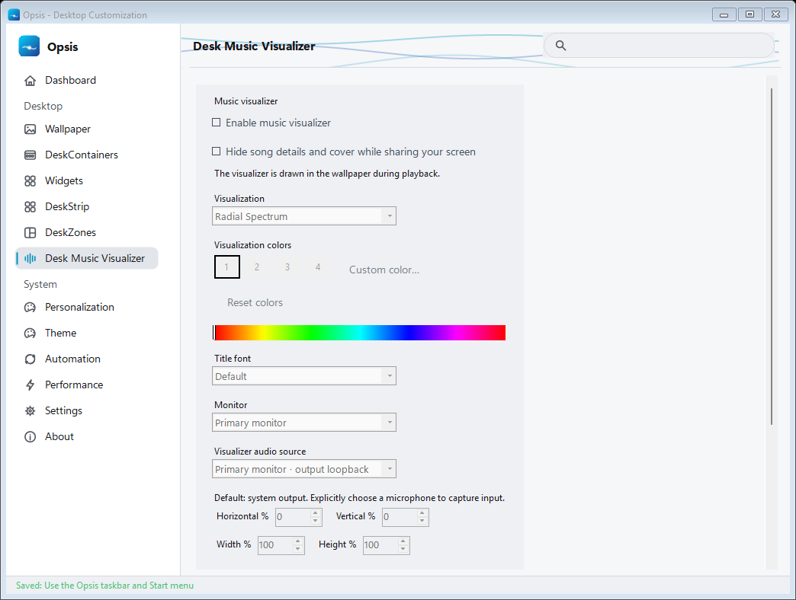</a> Desk Music Visualizer</td>
<td width="50%" valign="top"><a href="product-snapshots/page-Performance.png">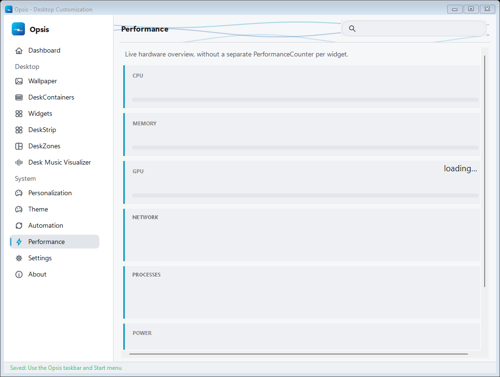</a> Performance</td>
</tr>
<tr>
<td width="50%" valign="top"><a href="product-snapshots/page-Settings.png">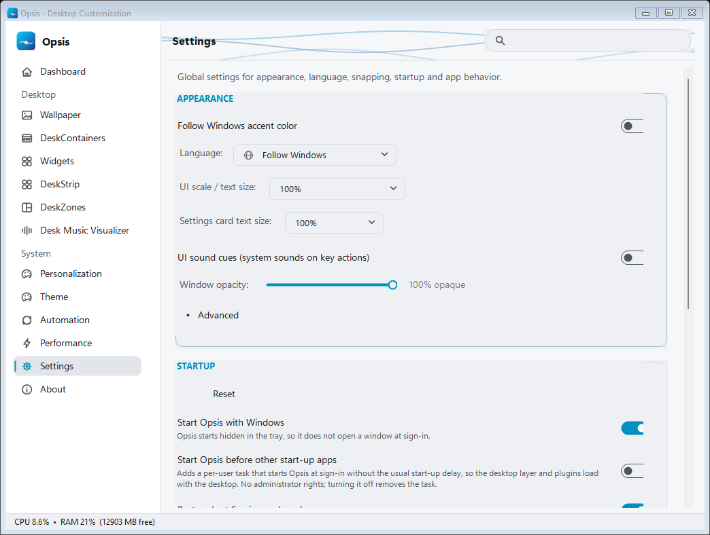</a> Settings</td>
<td width="50%"></td>
</tr>
</table>

---

Refresh the preview selection after the next release is finalized. / Ανανέωση εικόνων μετά την οριστικοποίηση επόμενης έκδοσης.
