# Application screenshots / Στιγμιότυπα εφαρμογής

Source commit: e1031e5c46469b879045ce731f80bc87bd2fb514

Actual application page captures from the UI audit on a disposable Windows VM; not a substitute for interactive testing.

### page-About.png

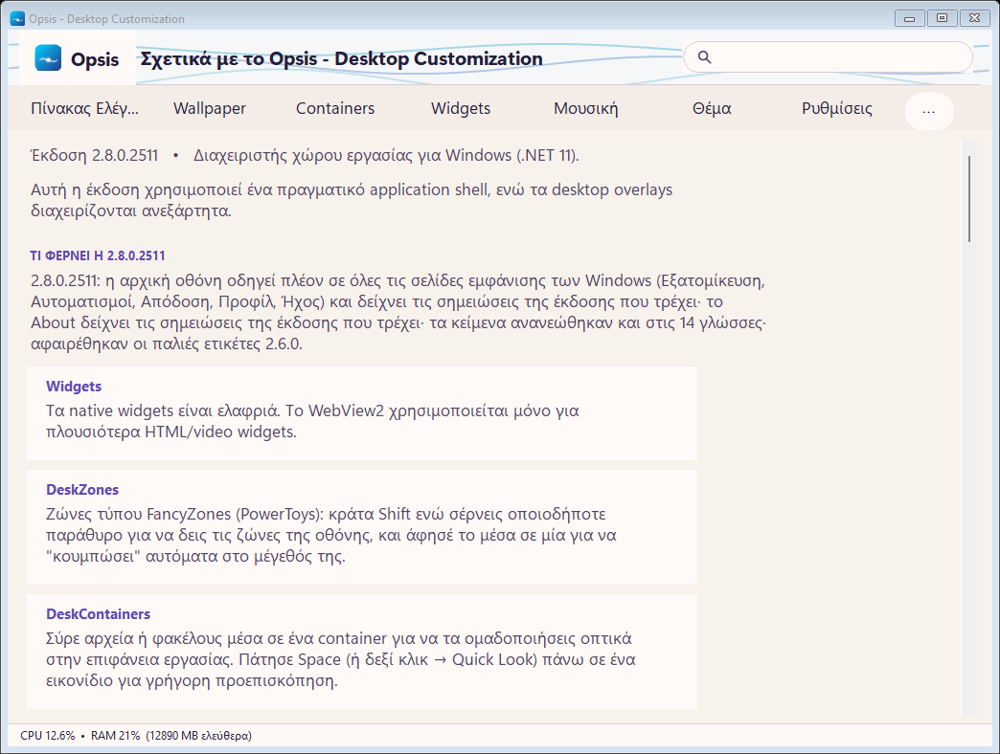

### page-Automation.png

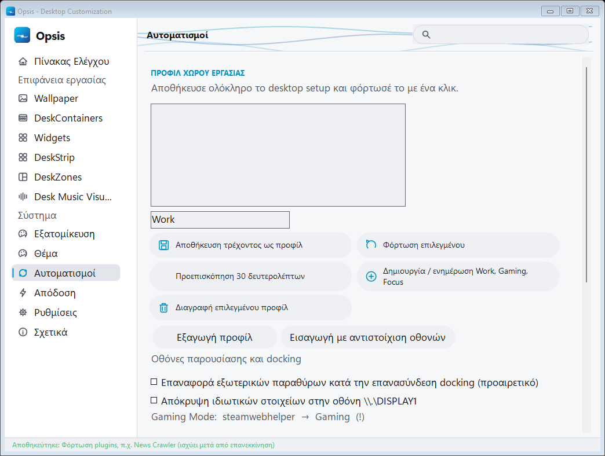

### page-Dashboard.png

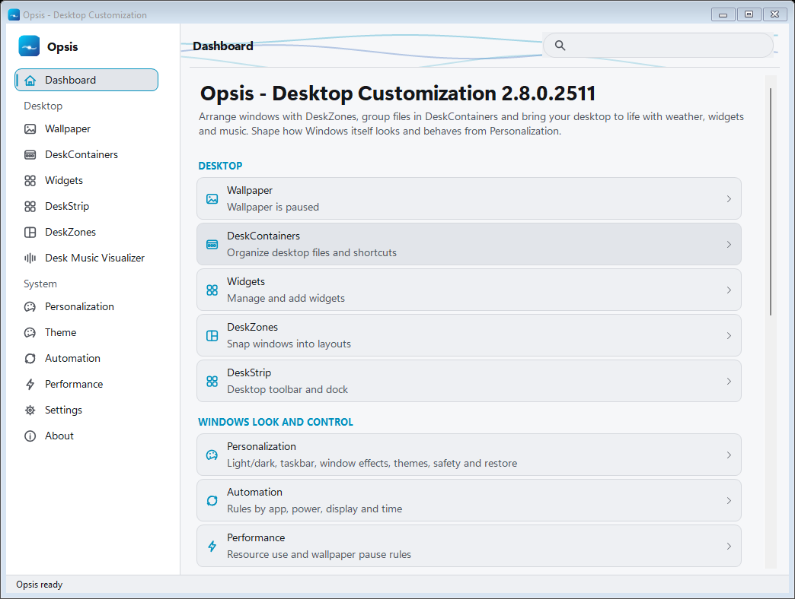

### page-DeskContainers.png

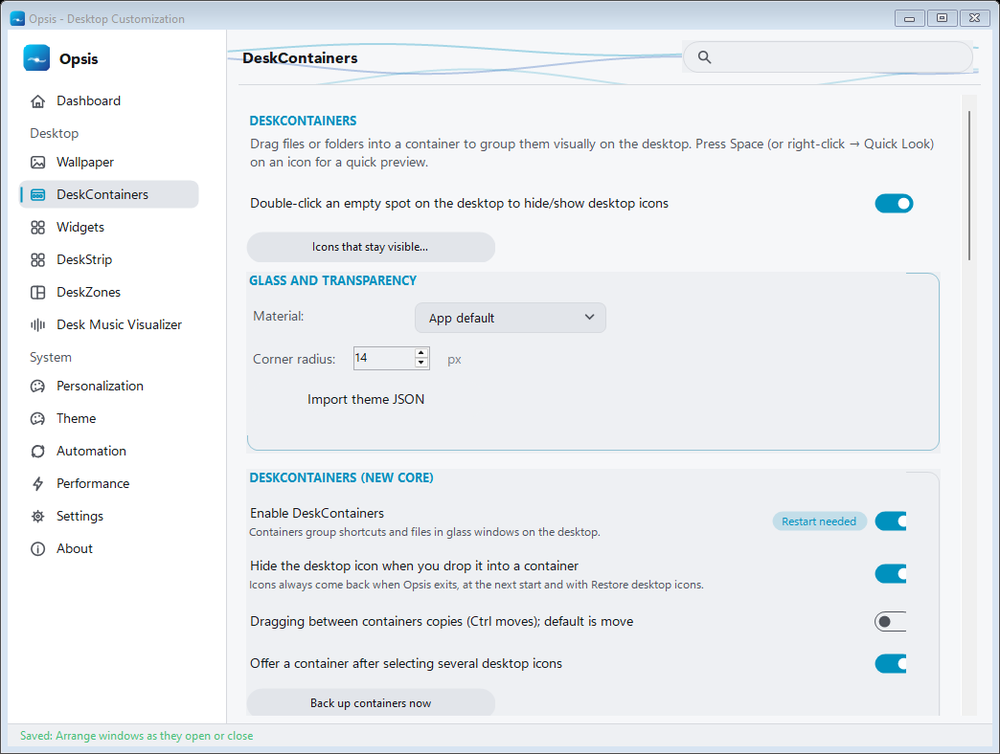

### page-DeskMusicVisualizer.png

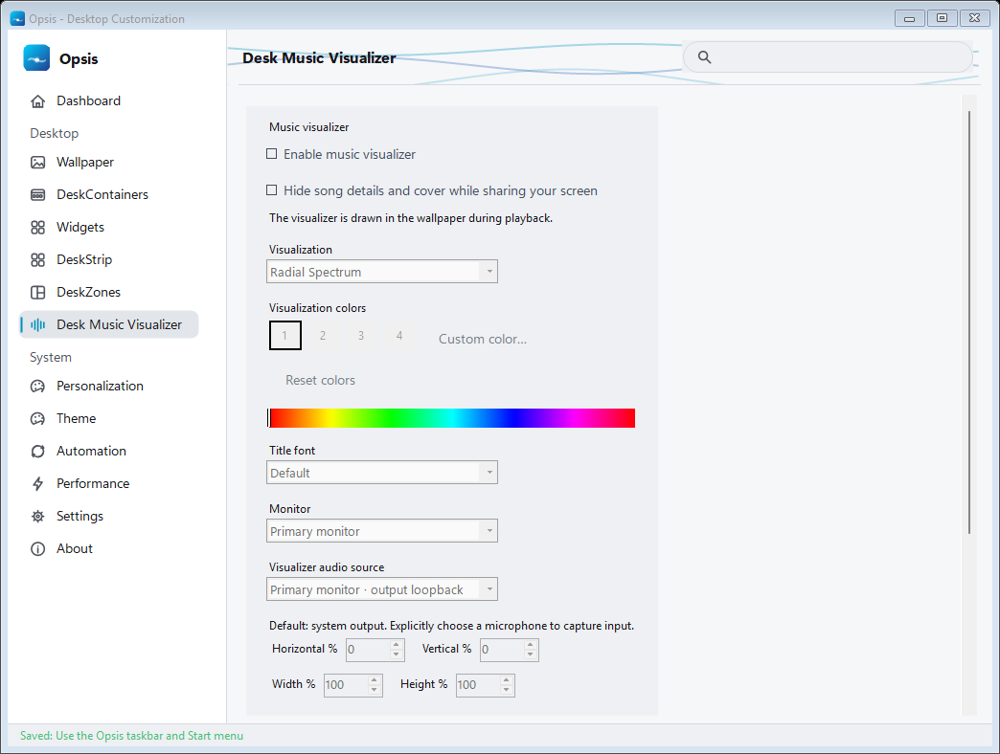

### page-DeskStrip.png

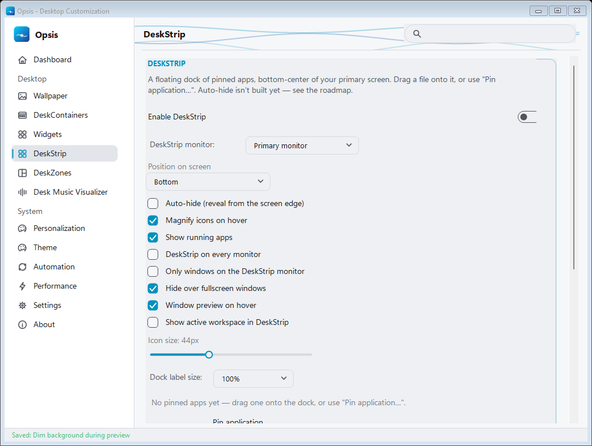

### page-DeskZones.png

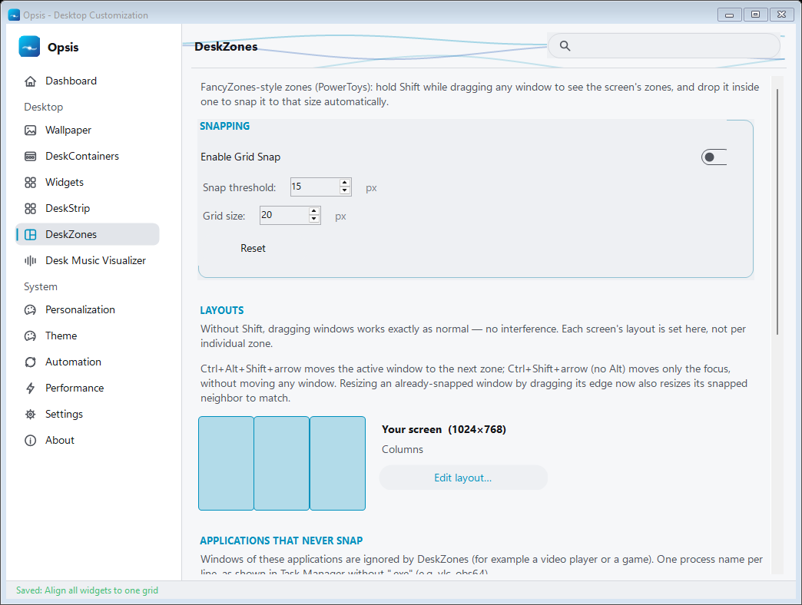

### page-Performance.png

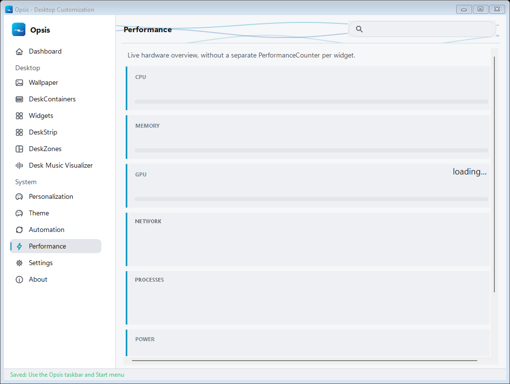

### page-Personalization.png

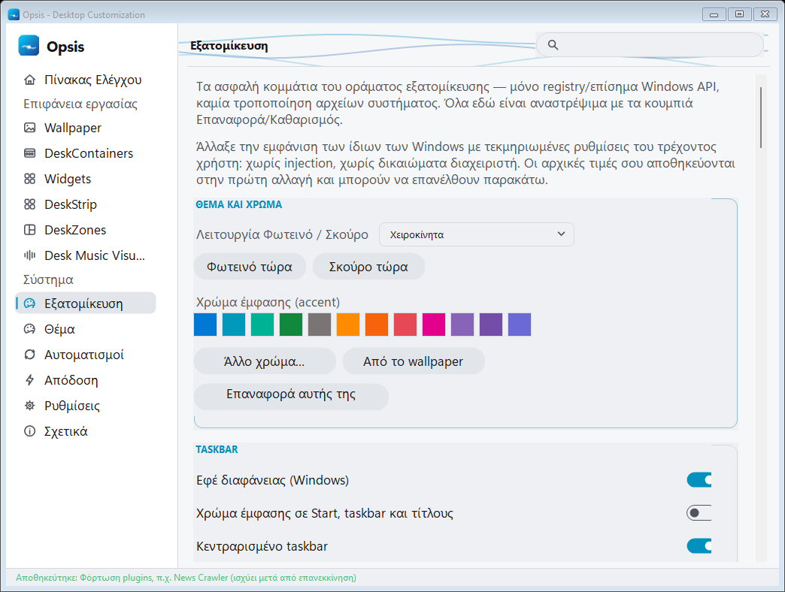

### page-Settings.png

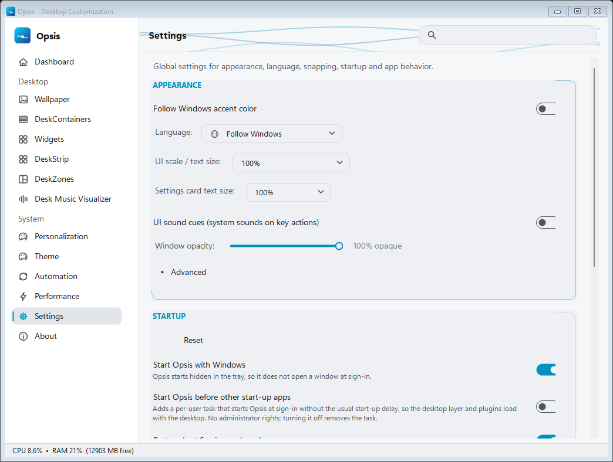

### page-Theme.png

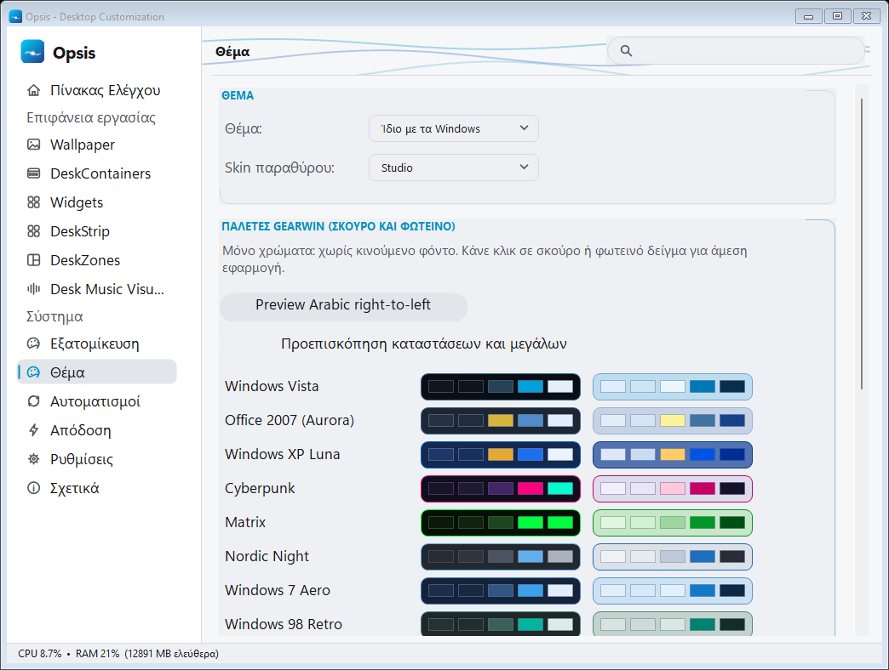

### page-Wallpaper.png

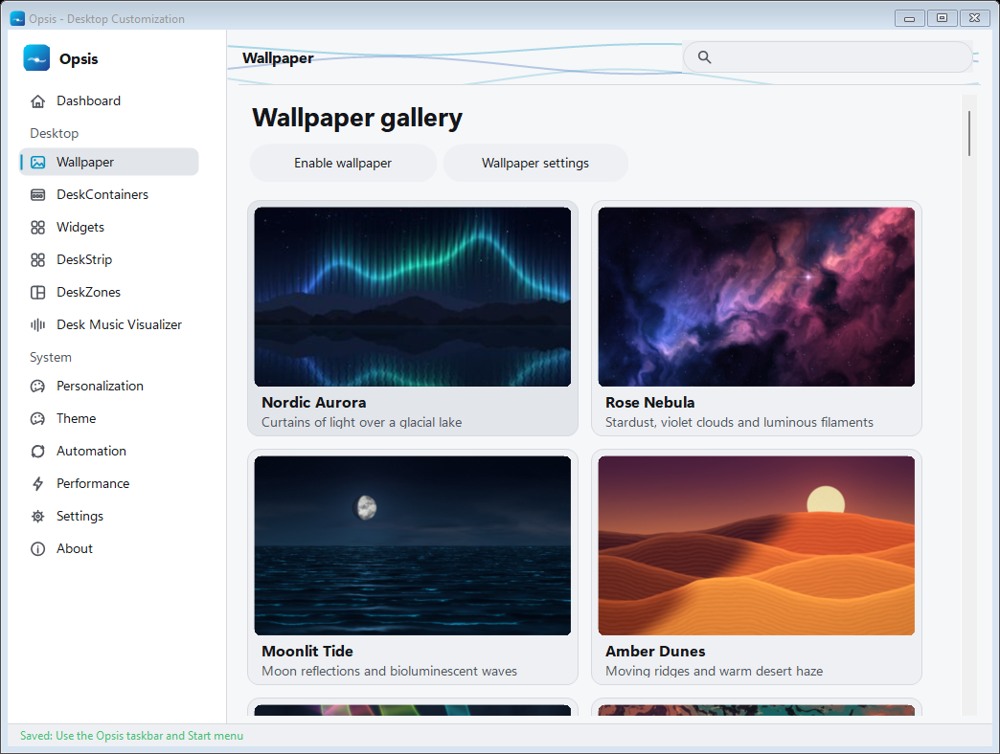

### page-Widgets.png

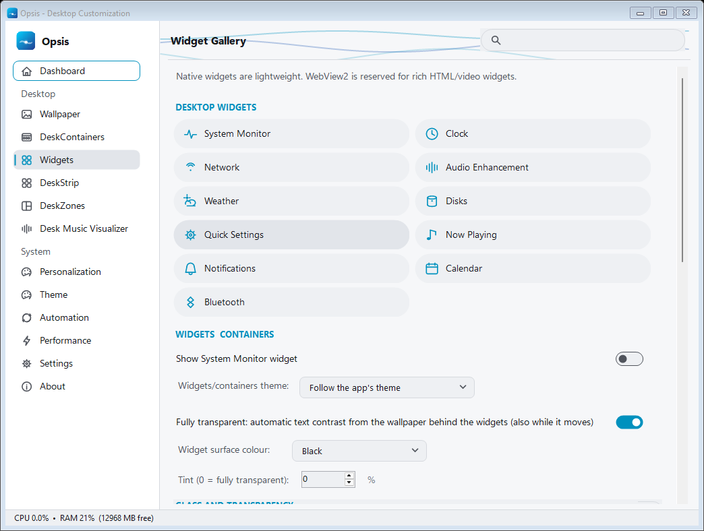

